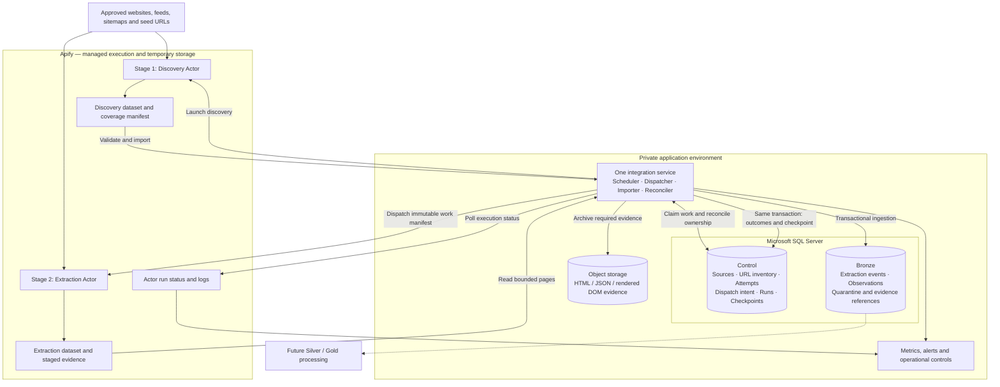

**I recommend keeping the two-stage architecture, Crawlee, SQL Server and—initially—hosted Apify. The main changes should strengthen the handoff, recovery and data-quality guarantees while simplifying deployment.**

The proposal already makes several good decisions: separating discovery from extraction, keeping SQL Server as the durable inventory, isolating Actors from the database, and acknowledging work only after ingestion. The remaining risks are concentrated around ambiguous Actor launches, expired leases, incomplete datasets, URL identity and silently incorrect extraction.

This review is based on the attached design and current official documentation. No implementation or file changes were made.

**The recommended MVP is one integration service, two Actor entry points and one SQL database.** The integration service should contain scheduling, dispatch, ingestion and reconciliation as modules. The Actors should share contracts, source adapters and utilities in one repository.

| Component | Responsibility |
|---|---|
| Source registry and profiles | Approved scope, discovery strategy, request context, parser version, freshness policy, domain limits and budgets. |
| Discovery Actor | Find candidate URLs within bounded scope; report discovery provenance and coverage. |
| Extraction Actor | Process assigned work, fetch pages, validate extraction and emit outcome envelopes with evidence references. |
| Apify storage | Temporarily retain outputs and execution state for ingestion and recovery. |
| Integration service | Own scheduling decisions, durable dispatch intent, Actor tracking, import, retries and reconciliation. |
| SQL control schema | Authoritative inventory, ownership, attempt history, scheduling and committed progress. |
| SQL Bronze schema | Durable extraction events and observations, including failure information and links to evidence. |
| Object storage | Retain selected response bodies and other evidence economically under an explicit retention policy. |
| Operational controls | Show freshness, coverage, errors, backlog and spend; support source pause, retry and parser rollback. |

**Stage 1 needs explicit coverage and URL-identity rules.**

The current design describes finding URLs well, but it does not establish how to distinguish a complete discovery run from a truncated or unhealthy one.

- **Use the cheapest discovery method suitable for each source.** Prefer permitted feeds/APIs, then sitemaps, then category pagination. Use browser discovery only when required. Stage 1 should usually discover detail-page links without loading every detail page before Stage 2 loads it again.
- **Emit a discovery manifest.** Include scope/configuration version, partitions or seeds attempted, failures, candidate counts, stop reason and continuation checkpoint. Reaching a page limit means partial coverage even if the Actor reports success.
- **Never retire URLs merely because they disappeared from one scan.** Missing URLs from an incomplete sitemap or failed category scan are not evidence of deletion. Use repeated verified absence or source-specific retirement rules.
- **Bound crawl traps.** Limit pagination, facet combinations, redirects, response sizes, decompressed sitemap sizes and total runtime. Alert on unexpected changes in discovery yield.
- **Separate discovery provenance from target ownership.** A directory may discover links belonging to several target websites. Preserve the discovery source while assigning each candidate to an approved target source before extraction.

Canonicalisation should be implemented once in a shared, versioned library and independently checked at ingestion. Preserve the original URL, normalized URL, final URL and redirect history. Treat a page’s canonical tag as a hint requiring source-specific interpretation.

Also include **request context** where it changes the facts: country, language, store or currency. The same URL may represent different observations in different contexts. Do not automatically strip variant parameters, lowercase paths, remove routing fragments or merge redirects.

A URL is a fetch target. Product/entity identity belongs downstream and should not be inferred solely from URL equality.

**The SQL-to-Apify handoff needs a precise failure-recovery protocol.**

The most important change is to distinguish durable scheduling intent from physical execution. SQL Server and the Apify API cannot participate in one atomic transaction.

I recommend this sequence:

1. **Claim work transactionally.** In one short SQL transaction, select eligible URLs, allocate immutable `attempt_id` values, increment ownership generations, create the submitted-work manifest and persist dispatch intent.
2. **Commit before calling Apify.** Network calls must happen outside the SQL transaction.
3. **Record ambiguous launches explicitly.** If the launch request times out, mark it `dispatch_unknown`. Reconcile recent runs and their input correlation identifiers before launching again.
4. **Bind the logical batch to its physical execution.** Store the actual Apify run and dataset IDs. Allow the data model to record duplicate physical executions if they occur.
5. **Import outputs from every terminal run state.** Failed, aborted and timed-out Actors may still contain useful successful observations.
6. **Commit ingestion atomically.** Insert events, record accepted outcomes, update eligible URL state and advance the dataset checkpoint in the same SQL transaction.
7. **Reconcile the manifest.** Compare assigned attempts with received outcomes. Retry only unresolved or retryable work after reconciling the previous execution.

The documented Actor-start endpoint does not provide a dispatch-idempotency parameter. A durable outbox therefore protects scheduling intent; it does not guarantee one physical launch. The API also returns run-specific storage identifiers, which should be used instead of “last run” endpoints. [Apify Run Actor API](https://docs.apify.com/api/v2/actors-runs-post)

For the MVP, dispatch-intent fields can live in `control.scrape_runs`. A separate outbox service or message broker is unnecessary.

**Lease expiry must trigger reconciliation, rather than immediate rescraping.**

Consider this failure:

> Actor A runs slowly. Its SQL lease expires. Actor B receives the same URL. Actor A then finishes and clears B’s lease or overwrites its scheduling state.

Add `current_attempt_id` and a monotonically increasing `lease_generation`. Every authoritative completion and lease renewal must match both values.

Late results can be preserved as historical evidence, but they must not clear newer ownership or move freshness backwards.

The service should distinguish:

- Actor still running.
- Actor finished; dataset awaiting import.
- Actor failed; partial output available.
- Execution outcome unknown.
- Previous attempt superseded.

An ingestion outage should cause **ingestion retries**, not repeated website requests. Bound lease renewal by execution/import deadlines, and pause new dispatch when ingestion backlog becomes unsafe.

Fencing protects SQL state. It does not stop an old Actor making HTTP requests. Reconcile and, where necessary, stop obsolete executions before permitting replacement runs against the same site.

**Separate URL lifecycle, attempt outcome and execution status.**

The proposed `pending / leased / succeeded / retryable_failed` URL state combines several different concepts. In particular, `succeeded` can accidentally become a terminal scheduling state even though the URL needs recurring capture.

| Record | Recommended responsibility and additions |
|---|---|
| `control.sources` | Versioned profiles, domain/rate-limit group, freshness policy, pause reason and budget. |
| `control.urls` | URL/context identity; lifecycle `active / paused / retired`; `next_scrape_at`; current attempt and lease generation; discovery and observation timestamps. |
| `control.scrape_runs` | Logical batch, immutable input manifest, dispatch intent and reconciliation state. |
| `control.actor_executions` | Physical Apify runs, dataset IDs, build IDs and provider status; supports duplicate launches without confusing logical work. |
| `control.url_attempts` | One scheduled attempt per claimed work item; outcome, diagnostics and at most one accepted terminal event. |
| `control.dataset_ingestions` | Dataset identity, next raw offset, ingestion version, completion state and last progress time. |
| `bronze.extraction_events` | Immutable result envelopes, unique event identity, provenance, payload and evidence references. |
| Quarantine records | Original rejected item, transport location and validation reason, retained before advancing past it. |

A previously successful URL remains active and becomes eligible again when due. A failed refresh does not erase its previous valid observation.

Use observation time for data freshness, ingestion time for pipeline latency, and a separate check timestamp for meaningful unchanged checks.

For SQL claiming, use a stored procedure with an ordered, bounded `UPDATE … OUTPUT` pattern and appropriate locking. `UPDLOCK`/`READPAST` can support this, but the exact hints depend on isolation configuration. `READPAST` has restrictions under `READ_COMMITTED_SNAPSHOT`, and skips row locks rather than page locks. Validate against the actual database settings. [Microsoft table-hint documentation](https://learn.microsoft.com/en-us/sql/t-sql/queries/hints-transact-sql-table)

Start with narrow indexes supporting:

- URL identity lookup, including request context where relevant.
- Due work by source, scheduled time and URL ID.
- Expired leases.
- Attempts by run and by URL/time.
- Unique event identity and dataset-ingestion identity.

Keep large JSON bodies out of scheduling indexes. Compare normalized URLs consistently rather than relying on case-insensitive SQL collation. A hash collision should cause explicit handling, never an accidental merge. Discovery upserts must preserve existing leases, retry state and freshness.

**Change the extraction contract to identify work, observations and delivery separately.**

The document’s `(dataset_id, dataset_item_id)` example assumes an item identity that is not automatically supplied as a business identifier. Apify exposes stored objects and positional pagination; the Actor should emit its own event ID. [Apify dataset-items API](https://docs.apify.com/api/v2/dataset-items-get)

Use these distinctions:

| Identity | Meaning |
|---|---|
| `url_id` + `request_context_id` | What resource/context is being observed. |
| `attempt_id` + `lease_generation` | Which scheduled assignment owns the work. |
| `apify_run_id` | Which physical execution produced the result. |
| `event_id` | Which observation/outcome envelope is being delivered. |

Re-delivering the same envelope must retain its `event_id`. A genuine refetch creates a new event, even if the extracted values are identical.

Enforce unique event IDs in Bronze. The same ID with identical content is a replay; the same ID with conflicting content is a contract error. Separately, accept at most one authoritative terminal result for each logical attempt.

The result envelope should include:

- Work identifiers, source and request context.
- Requested/final URL and fetch timestamp.
- HTTP status, nullable when no response was received.
- Outcome and structured error/validation reasons.
- Parser, configuration, schema and Actor build versions.
- Extracted records, evidence references and hashes.

Define whether a work item can produce zero, one or multiple business records. “One event per URL” should mean a terminal envelope accounting for the assigned work, not necessarily one business row.

A killed Actor cannot guarantee that every assignment produces an event. Missing results belong in reconciliation as unknown or uncompleted work; do not fabricate fetch observations.

**Stage 2 needs to establish usable extraction before declaring success.**

HTTP 200 can contain a login page, challenge page, soft 404, empty application shell or the wrong market’s prices.

Each source adapter should check page identity, required fields and source-specific invariants. Missing price must remain distinct from zero; unavailable data must remain distinct from “out of stock.” Preserve useful source strings alongside parsed values—for example, the original price text and currency context.

Use versioned source adapters with fixture tests. Configuration can handle selectors and limits; complex site behavior should remain understandable code rather than becoming a custom scraping configuration language.

Stage 2 should also stay within its assigned work manifest. New links it discovers should return through validated discovery intake.

For fetching, use HTTP/Cheerio by default and Playwright where JavaScript rendering is required. Crawlee supports both approaches. [Crawlee crawler selection](https://crawlee.dev/js/docs/quick-start)

Use a fresh execution queue for each scheduled batch, with explicit work-aware request keys such as `attempt_id`. Otherwise queue deduplication can collapse distinct assignments or suppress later refreshes. Crawlee’s request identity and storage behavior are documented separately from warehouse identity. [Crawlee Request](https://crawlee.dev/js/api/core/class/Request), [request storage](https://crawlee.dev/js/docs/guides/request-storage)

**Rate limits and retries must be controlled across both stages.**

Per-Actor concurrency limits do not enforce a shared website budget. Discovery and extraction can individually obey their settings while collectively overloading the same domain.

For the MVP, permit one active fetching run per rate-limit group, with bounded batches and extraction priority where freshness requires it. Group sources that share the same website budget.

Configure request retries, session rotations, Actor restart behavior and scheduled retries explicitly. Crawlee session rotations are not counted within `maxRequestRetries`, so setting that value alone does not bound the total work. [Crawlee options](https://crawlee.dev/js/api/basic-crawler/interface/BasicCrawlerOptions)

Use different responses to different failures:

| Failure | Recommended behavior |
|---|---|
| Transient network error or selected 5xx | Bounded local retry; later scheduled retry with jitter if needed. |
| 429 | Respect the indicated delay and reduce shared site pressure. |
| Widespread blocking | Pause the source and investigate. |
| Parser/schema regression | Quarantine evidence and pause the affected parser version. |
| Verified missing page | Apply source-specific retirement/recheck policy. |
| SQL/import failure | Retry ingestion using retained output. |

**Apify datasets need an explicit retention and ingestion policy.**

For the MVP, polling is sufficient and avoids a public webhook endpoint. Webhooks can reduce latency later. If introduced, persist the notification before acknowledging it and retain polling reconciliation: Apify documents duplicate delivery and finite retries. [Webhook actions](https://docs.apify.com/integrations/webhooks/actions)

Import bounded pages in ascending, untransformed form. Avoid `clean`, `skipEmpty`, `unwind` and changing views in checkpointed ingestion because they can omit or expand records. Persist the next raw offset with the corresponding SQL writes.

Do not infer completeness from a single item count or empty response. Dataset metadata counts can lag writes; combine output draining with terminal execution status and assignment reconciliation. [Dataset metadata API](https://docs.apify.com/api/v2/dataset-get)

Set retention to exceed the required outage/recovery window. Unnamed-storage retention depends on the selected plan/configuration; named storage avoids automatic expiry but still needs cleanup. [Apify storage and retention](https://docs.apify.com/storage)

Use an MVP operational rule that finalized runs are not resurrected. Start fresh runs for unresolved work, keeping completed ingestion boundaries stable.

**Bronze should preserve enough evidence to explain and repair the data.**

The proposed successful-only structured output is a useful observation history, but it cannot reconstruct fields lost by a parser defect.

Retain failure and quarantine information as well as successful observations. Define an evidence policy before implementation:

- Parser failures and representative successful responses should be retained for diagnosis.
- Full historical reprocessing requires retaining the necessary response evidence for every covered observation.
- Browser-derived extraction may require rendered DOM or relevant response bodies; screenshots alone are insufficient for parser replay.

Store large evidence outside SQL Server using immutable object keys, checksums and retention classes. If evidence durability is part of completion, archive and verify it before committing the SQL reference and success. Handle already-uploaded objects on retry and clean abandoned uploads later.

Keeping compact structured Bronze in SQL Server is reasonable initially. Monitor transaction-log growth, backup/storage cost and interference between ingestion, analytics and scheduling. Separate schemas provide organizational and permission boundaries, but share database resources.

**The implementation approach should minimise operational machinery.**

I would use TypeScript for the Actors and integration service, shared JSON Schema contracts, custom source adapters and pinned Actor builds. This keeps one language across the ingestion boundary. A strongly Python-oriented team could reasonably choose Crawlee Python instead; this decision should follow team capability and representative-source testing.

Use owned Actors for core contractual data. Evaluate marketplace Actors individually for schema stability, provenance, version control, maintenance and total cost.

These open-source options provide specific advantages:

| Tool or implementation | Advantage | Recommendation |
|---|---|---|
| [Crawlee](https://github.com/apify/crawlee) | Existing fit for HTTP and browser scraping; preserves an option to move execution into ordinary containers. | Keep for MVP. |
| [Ajv](https://github.com/ajv-validator/ajv) | Shared JSON Schema validation at Actor input/output and ingestion boundaries. | Add for MVP; avoid silently coercing evidence during validation. |
| [Scrapy](https://github.com/scrapy/scrapy) | Established Python crawling framework for teams whose expertise and integrations are predominantly Python. | Credible alternative, without a demonstrated reason to replace Crawlee here. |
| [Temporal](https://github.com/temporalio/temporal) | Durable orchestration when long-running workflows, timers and recovery paths become difficult to maintain. | Consider later; external actions still require idempotency and reconciliation. |

I would defer Airflow, Dagster, Prefect, Kafka, Redis and Kubernetes unless a measured requirement justifies one. They do not resolve the SQL-to-Apify transaction gap by themselves.

Keep SQL access private and use restricted credentials and storage permissions. Extend SSRF protection beyond initial URL validation to redirects, resolved addresses and browser requests. Evidence references should resolve only through approved storage locations. [OWASP SSRF guidance](https://cheatsheetseries.owasp.org/cheatsheets/Server_Side_Request_Forgery_Prevention_Cheat_Sheet.html)

**Prioritise changes according to correctness first, then measured operating pressure.**

| Essential for MVP | Introduce as the business scales |
|---|---|
| Shared contracts and source adapters | Automated parser canaries and drift analysis across many sources |
| Discovery coverage and safe URL/context identity | Adaptive discovery and revisit schedules |
| Atomic claims, ownership fencing and durable dispatch intent | More dispatch/ingestion workers when backlog requires them |
| Manifest reconciliation and recovery of partial outputs | Distributed domain-rate coordination when concurrent runs per site are necessary |
| Idempotent ingestion, quarantine and retention guarantees | Bulk staging and object-storage history when SQL cost or contention justifies it |
| Polling, bounded retries and source pause controls | Webhooks where lower notification latency matters |
| Explicit evidence retention and basic replay capability | Broader capture/reprocessing according to product commitments |
| Freshness, coverage, ingestion-lag and cost metrics | Workflow engine when recovery complexity becomes an operating burden |
| Backup and restore verification | Stronger workload isolation as availability requirements grow |

Measure **cost per 1,000 valid, fresh, committed observations**. Include discovery, unsuccessful requests, browser time, proxies, duplicate execution, Apify storage/API use, SQL storage/backups and operating effort. This is the basis for comparing hosted Apify with self-hosting; infrastructure prices alone are insufficient.

The implementation sequence should establish contracts and ownership rules first, then deliver one source end to end, exercise recovery failures, and only then expand source coverage.

Before production sign-off, require demonstrations that:

1. Concurrent claimers cannot obtain the same current ownership.
2. A lost launch response does not cause uncontrolled duplicate execution.
3. A late result cannot clear a newer lease.
4. Replayed datasets and lost acknowledgements do not duplicate committed events.
5. Failed Actors retain partial successes and every assignment is accounted for.
6. SQL outages trigger recoverable ingestion without unnecessary rescraping.
7. Partial discovery never incorrectly retires URLs.
8. Challenge pages and parser regressions cannot silently count as successful extraction.
9. Selected retained evidence can be replayed through a corrected parser.
10. Source pause, parser rollback and database restore procedures work.

Final sizing still requires the expected URL population, refresh frequency, browser percentage, payload/evidence sizes, retention period and recovery objectives. Those inputs should determine batch sizes, capacity and budgets; the correctness guarantees above are necessary regardless of scale.