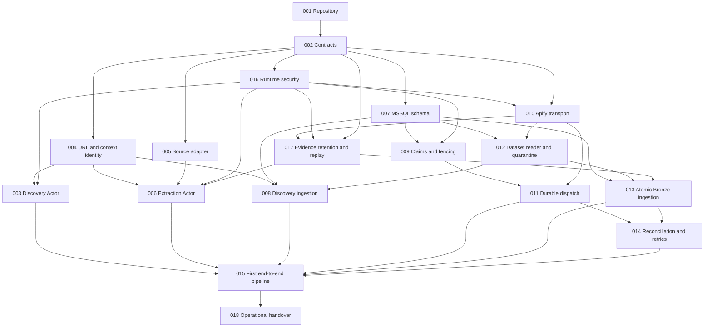

# Micro-specification dependency graph

Version 0.1. Status: proposed for G0 review. An arrow means **prerequisite must be verified before dependent implementation is merged**. Source-specific decisions are separate readiness gates, not graph nodes and not hidden implementation dependencies.

## Direct predecessor list

This table is normative for dependency auditing; the Mermaid graph must match it. Transitive dependencies are not repeated unless useful at a public boundary.

| Spec | Direct prerequisites |
|---|---|
| 001 | none; G0 and D-01 still apply |
| 002 | 001 |
| 003 | 004, 016 |
| 004 | 002 |
| 005 | 002 |
| 006 | 004, 005, 016, 017 |
| 007 | 002 |
| 008 | 004, 007, 012 |
| 009 | 007, 016 |
| 010 | 002, 016 |
| 011 | 009, 010 |
| 012 | 007, 010 |
| 013 | 007, 012, 017 |
| 014 | 011, 013 |
| 015 | 003, 006, 008, 011, 013, 014 |
| 016 | 002 |
| 017 | 002, 010, 016 |
| 018 | 015 |

One valid topological order is: **001, 002, 004, 005, 007, 016, 003, 009, 010, 011, 012, 017, 006, 008, 013, 014, 015, 018**.

## Parallel opportunities and checkpoints

After contracts are verified, 004/005/007/016 can run in parallel with separate file ownership. Then discovery, claiming and Apify transport can progress independently as their predecessors finish. After transport, 011/012/017 are parallel candidates; after those boundaries, 006/008/013 can progress independently. Reconciliation is integrated before 015; operational handover follows the first pipeline.

Mocks and fixture design may be drafted earlier against approved contracts, but no dependent merge can rely on an unverified or incompatible prerequisite. Database migration ownership remains serial even when its consuming modules are parallel. [The execution plan](implementation-plan.md) specifies integration checkpoints and review evidence.
