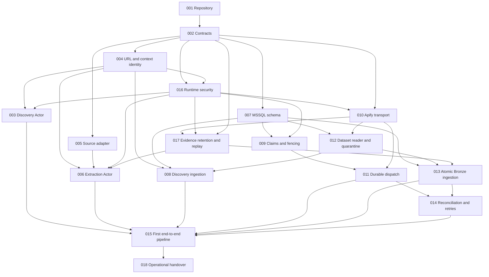

# Micro-specification dependency graph

Version 0.3, 18 October 2026. Status: scoped execution approved through SPEC-016's controlled-fixture HTTP implementation; later readiness gates remain open. An arrow means **prerequisite must be verified before dependent implementation is merged**. Source-specific decisions are separate readiness gates, not graph nodes and not hidden implementation dependencies. This graph has **18 nodes and 38 edges**; the new 004 → 016 edge records actual reuse of the verified URL normalizer.

Execution status, 18 October 2026: SPEC-001/002/004 are verified and integrated into `dev` at `73d72716b1d2d26150884dbf31c78dce0a03b76f`. SPEC-016's approved controlled scope is verified on `feat/spec-016-runtime-security`; see [its report](../../reports/implementation/SPEC-016/REPORT-20261018-04.md), [ADR-0004](decisions/ADR-0004-controlled-http-security.md), [plan](plans/SPEC-016.md) and [approval register](approval-register.md). Its direct predecessor gate is satisfied by [SPEC-002's evidence](../../reports/implementation/SPEC-002/REPORT-20261018-02.md) and [SPEC-004's evidence](../../reports/implementation/SPEC-004/REPORT-20261018-03.md). Real-source/hosted-network/storage/live-budget/SQL gates remain open. Local configuration/HTTP tests do not prove Apify, actual grants or evidence-provider enforcement. Commit/push/merge and the next start require further user approval. Work remains one spec at a time.

## Direct predecessor list

This table is normative for dependency auditing; the Mermaid graph must match it. Transitive dependencies are not repeated unless useful at a public boundary.

| Spec | Direct prerequisites |
|---|---|
| 001 | none; G0 and D-01 still apply |
| 002 | 001 |
| 003 | 004, 016 |
| 004 | 002 |
| 005 | 002 |
| 006 | 004, 005, 016, 017 |
| 007 | 002 |
| 008 | 004, 007, 012 |
| 009 | 007, 016 |
| 010 | 002, 016 |
| 011 | 009, 010 |
| 012 | 007, 010 |
| 013 | 007, 012, 017 |
| 014 | 011, 013 |
| 015 | 003, 006, 008, 011, 013, 014 |
| 016 | 002, 004 |
| 017 | 002, 010, 016 |
| 018 | 015 |

One valid topological order is: **001, 002, 004, 005, 007, 016, 003, 009, 010, 011, 012, 017, 006, 008, 013, 014, 015, 018**.

## Parallel opportunities and checkpoints

After contracts are verified, 004/005/007 are graph-independent candidates with separate file ownership. SPEC-016 follows verified 004 because its enforcement boundary reuses the normalizer. Then discovery, claiming and Apify transport can progress independently as their predecessors finish. After transport, 011/012/017 are parallel candidates; after those boundaries, 006/008/013 can progress independently. Reconciliation is integrated before 015; operational handover follows the first pipeline. The current user-authorised workflow still implements one specification at a time; these graph opportunities do not independently authorise another start.

Mocks and fixture design may be drafted earlier against approved contracts, but no dependent merge can rely on an unverified or incompatible prerequisite. Database migration ownership remains serial even when its consuming modules are parallel. [The execution plan](implementation-plan.md) specifies integration checkpoints and review evidence.
