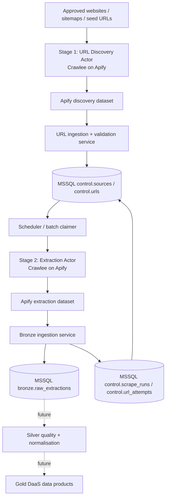

# DaaS Platform — Stages 1 & 2: URL Discovery and Data Extraction

**Status:** Proposed architecture for review (not an implemented system)  
**Date:** 15 October 2026  
**Scope:** URL discovery, URL inventory/control plane, field extraction and raw Bronze landing in Microsoft SQL Server. Silver/Gold and customer delivery are future stages.

## 1. Executive summary

The DaaS business needs a repeatable way to find relevant URLs and then extract the business data from those URLs. These are **two separate workloads** managed via the **Apify ecosystem**, using **Crawlee** for crawling/scraping.

- **Stage 1 — URL Discovery Actor:** Visits selected seed websites, directories, category pages and/or sitemaps; discovers in-scope target URLs; publishes a structured URL-discovery dataset.
- **Integration/control layer — URL Inventory:** A separate ingestion/orchestration service reads Stage 1 output, validates and deduplicates URLs, and upserts them into a durable **MSSQL `control` schema**. This is operational metadata, **not** Bronze business data.
- **Stage 2 — Field Extraction Actor:** Receives a batch of due URLs from the control layer, fetches target pages using Crawlee, extracts source-specific fields, and writes structured extraction results into an Apify dataset.
- **Bronze landing:** An ingestion service imports the extraction dataset into append-only, source-attributed **MSSQL `bronze`** tables and acknowledges completion of URL work only after durable loading.

**Design principle:** SQL Server tracks *which URLs exist, when they need scraping, and what has been committed*. Apify/Crawlee controls *how a particular run executes*. The two systems must not be treated as interchangeable queues.

## 2. Architecture



### Component responsibilities

| Component | Owns | Does not own |
|---|---|---|
| Discovery Actor | Links, sitemap parsing, discovery crawl rules, discovery run dataset | Long-lived URL catalogue; business-field extraction |
| URL ingestion service | URL canonicalisation, allowlist and scope checks, idempotent upserts, ingestion audit | HTML extraction |
| SQL Server control schema | Source registry, URL inventory, freshness policy, leasing, run/attempt status | Crawlee's internal per-run request scheduling |
| Extraction Actor | Fetching URLs, parsing required fields, extraction provenance, per-run output | Canonical master URL catalogue; final warehouse commits |
| Bronze ingestion service | Deduped, append-only loading; durable write acknowledgments | Cleansing business facts into Silver |
| Apify platform | Actor execution, scheduling, run logs, resources, per-run datasets/queues | Source-of-truth URL catalogue and warehouse history |

## 3. Stage 1 — URL discovery

**Inputs:** `source_id`, approved seed URLs, allowed domains/path rules, page or URL limits, pagination/sitemap options, `discovery_run_id`.

**Expected process:**
1. Start an Apify Actor built using Crawlee.
2. Fetch approved seed pages, follow in-scope links, optionally inspect XML sitemaps, and handle pagination as required.
3. Filter targets by agreed criteria (e.g., product/detail pages only), normalise URLs consistently, and record where each URL was found.
4. Emit one discovery record per canonical candidate URL to an Apify dataset.
5. URL ingestion service consumes the run dataset, validates URLs again, and upserts them to SQL Server. Repeated discovery updates `last_discovered_at` rather than creating duplicates.

**Discovery dataset contract (example):**

```json
{
  "discovery_run_id": "disc_20261015_001",
  "source_id": 12,
  "discovered_url": "https://example.com/products/widget-a?utm_source=search",
  "canonical_url": "https://example.com/products/widget-a",
  "found_on_url": "https://example.com/category/widgets",
  "page_type": "product",
  "discovered_at": "2026-10-15T09:30:00Z",
  "discovery_method": "category_link"
}
```

**Important:** canonicalisation rules must be source-aware. Remove tracking parameters only where safe; do **not** remove query parameters that identify products, variants or pagination. Enforce hostname/path allowlists and block non-HTTP(S), localhost/private-network/metadata-service targets to mitigate SSRF if URL sources are untrusted.

## 4. MSSQL URL inventory (the handoff between the two Actors)

Use a `control` schema for operational metadata and a `bronze` schema for raw observations. This can reside within one SQL Server database for the MVP, with separate permissions.

### Minimum logical schema

**`control.sources`**
- `source_id` (PK), `source_name`, `base_domain`, `enabled`, `discovery_schedule`, `extraction_profile`, `rate_limit_policy`, `created_at`.

**`control.urls`**
- `url_id` (PK), `source_id` (FK), `canonical_url`, `url_hash`, `page_type`, `first_discovered_at`, `last_discovered_at`, `last_success_at`, `next_scrape_at`, `status`, `failure_count`, `lease_owner`, `lease_expires_at`, `created_at`, `updated_at`.
- Unique `(source_id, url_hash)` **plus comparison with canonical URL** if a hash collision is detected. Consider SQL Server index-size limits before attempting a unique index directly on `NVARCHAR(2048)`.
- Recommended states: `pending`, `leased`, `succeeded`, `retryable_failed`, `permanent_failed`, `disabled`.

**`control.scrape_runs`**
- `run_id` (PK), `actor_type` (`discovery`/`extraction`), `apify_run_id`, `started_at`, `ended_at`, `status`, counters, and source/dataset identifiers.

**`control.url_attempts`**
- `attempt_id` (PK), `url_id` (FK), `run_id` (FK), `started_at`, `finished_at`, `http_status`, `result_status`, `error_class`, `error_detail`, `bronze_record_id` (nullable).

**`control.dataset_ingestions`**
- `ingestion_id` (PK), `apify_dataset_id`, `run_id`, `ingestion_status`, `last_processed_item`, `started_at`, `finished_at`; enables import resume and audit.

**`bronze.raw_extractions`**
- `bronze_record_id` (PK), `url_id`, `run_id`, `attempt_id`, `source_id`, `observed_at`, `ingested_at`, `http_status`, `extractor_version`, `schema_version`, `payload_json` (`NVARCHAR(MAX)` with `ISJSON` check), `payload_hash`, optional `raw_html_reference` and `content_hash`.
- This table is **append-only** for successful observations; do not overwrite yesterday's measurements. Use a stable ingestion idempotency key, e.g. `(run_id, url_id, extraction_event_id)` or `(dataset_id, dataset_item_id)`, not just URL.

### Illustrative URL row

```json
{
  "url_id": 1001,
  "source_id": 12,
  "canonical_url": "https://example.com/products/widget-a",
  "status": "pending",
  "last_success_at": null,
  "next_scrape_at": "2026-10-15T10:00:00Z",
  "failure_count": 0
}
```

## 5. Stage 2 — Business-field extraction

**Inputs:** an `extraction_run_id`, `source_id`, batch of `{url_id, canonical_url}`, extraction profile/version, crawl limits and timeouts.

**Expected process:**
1. Scheduler atomically claims a bounded batch of due URLs from `control.urls`; assigns a time-limited lease and records a run/attempt.
2. Scheduler invokes the configured extraction Actor via Apify API and supplies this batch as Actor input (or an input dataset reference for large batches).
3. Extraction Actor uses Crawlee's **per-run** request queue to process URLs, respecting concurrency, site rate limits and retry policies.
4. A source-specific extraction profile selects the required business fields. Store provenance and explicitly distinguish `not_found`, `blocked`, `parse_error`, and successful extraction.
5. Extraction Actor outputs one structured event per attempted URL, including success/failure and extraction version, to an Apify dataset.
6. Bronze ingestion service loads successful events into SQL Server and writes attempt outcomes. Mark URLs successful and schedule their next refresh **only after** durable Bronze commit.
7. Retryable failures receive an exponential-backoff next attempt; non-retryable failures are recorded for review. Expired leases are reclaimable.

**Extraction output contract (example; business fields are niche-specific):**

```json
{
  "extraction_event_id": "ext_001_1001_1",
  "extraction_run_id": "extract_20261015_001",
  "url_id": 1001,
  "source_id": 12,
  "requested_url": "https://example.com/products/widget-a",
  "final_url": "https://example.com/products/widget-a",
  "scraped_at": "2026-10-15T10:01:00Z",
  "http_status": 200,
  "outcome": "success",
  "extractor_version": "retailer-a-v1.0.0",
  "schema_version": 1,
  "fields": {
    "product_name": "Widget A",
    "price": 19.99,
    "currency": "GBP",
    "availability": "in_stock"
  }
}
```

**Bronze principle:** Keep the data close to the original extraction, with source, time, version and errors for audit. Apply type standardisation, entity resolution and cross-source matching downstream in Silver, not inside the URL control plane.

## 6. End-to-end sequence and state transitions

1. `Discovery Actor -> Apify discovery dataset`.
2. `URL ingestion -> control.urls` using idempotent upsert; newly found URLs set `pending`/due.
3. `Scheduler -> control.urls` atomically claims N due URLs; marks `leased` and sets `lease_expires_at`.
4. `Scheduler -> Apify extraction Actor` with those URL IDs and URLs; records `apify_run_id`.
5. `Extraction Actor -> Apify extraction dataset` with a result event for every attempted URL.
6. `Bronze ingestion -> bronze.raw_extractions` with idempotency key and transactionally records status/attempt outcomes.
7. `Control update`: success -> `succeeded`, set `last_success_at`, compute `next_scrape_at`; retryable failure -> `retryable_failed`, schedule backoff; terminal failure -> `permanent_failed` or manual review.
8. `Recovery`: if an Actor/worker dies, reconcile Apify run status and reclaim expired leases; re-ingestion must not duplicate Bronze rows.

**Do not assume that an Apify Actor completing successfully means the records reached SQL Server.** Track Actor completion and SQL ingestion completion separately.

### Operating model choice

For MVP, use an external integration/orchestration service that talks to both Apify API and SQL Server. Avoid opening SQL Server directly to internet-facing Actors. Use managed secrets, restricted networking and least-privilege DB accounts. Apify webhooks can trigger ingestion, but ingestion must also support scheduled reconciliation because webhook delivery can be repeated or missed.

## 7. Engineering requirements and constraints

- **Legal/ethical:** honour applicable site terms, access permissions, robots guidance where appropriate, rate limits, privacy/data-protection requirements and contractual restrictions. No bypass of access controls.
- **Rate limiting:** configurable per domain/source; backoff on 429 and 5xx responses; prevent concurrent runs overloading a domain.
- **Security:** approved domain allowlists, SSRF protection, parameterised SQL, secrets manager, no secrets in logs, no publicly exposed MSSQL instance.
- **Durability:** idempotent URL upserts and extraction ingestion; recoverable cursors/checkpoints; DLQ/manual-review for persistent failures.
- **Observability:** discovery count, new-vs-known URLs, URLs due/leased/stuck, extraction success rate, error breakdown, average cost per 1,000 pages, latency from discovery to Bronze, dataset ingestion lag, Apify run ID correlation.
- **Scale:** batch inputs and datasets; bounded Actor memory/concurrency; appropriate SQL indexes; raw HTML stored externally (blob/object storage) rather than in the main transactional URL table if needed.
- **Testing:** fixtures for URL normalisation, HTML parser changes, retries, failed Actor runs, missing datasets, duplicate webhooks, lost acknowledgements, overlapping workers and historical observations.

## 8. Recommended MVP build sequence

1. Define one niche, one source, target page type and minimum extracted field contract.
2. Implement one Crawlee URL-discovery Actor and inspect its Apify output.
3. Build `control.sources`, `control.urls`, `control.scrape_runs` and idempotent discovery ingestion.
4. Implement bounded batch claiming and one extraction Actor.
5. Build raw Bronze ingestion plus attempts/audit and idempotent commits.
6. Add scheduling/retry/reconciliation, metrics and alerts.
7. Test with multiple sources, parser versions and recurring captures before building Silver/Gold.

## 9. Design decisions needing validation

1. **Hosting and language:** Crawlee TypeScript vs Python; hosted Apify vs self-hosted alternatives.
2. **Control plane:** whether a small orchestrator/service is sufficient or Prefect/Dagster/Airflow is justified later.
3. **Actor communication:** webhook-triggered ingestion vs polling, and robust retry/reconciliation design.
4. **Queue boundaries:** SQL leasing for due work vs relying more heavily on Apify queues, without losing inventory/history.
5. **SQL Server economics:** suitable for operational inventory plus Bronze at anticipated scale? When is object storage preferable for raw HTML?
6. **URL identity:** canonicalisation, redirects, query-string variants, duplicates and deletions.
7. **Data contract:** per-niche extraction schema and source-specific versioned parsers.
8. **Freshness:** changing revisit cadence based on source, page changes, customer SLAs and scraping cost.
9. **Compliance:** permissible crawling methods and licensed/public data distinctions, including personal data.

## 10. Codex review brief (copy/paste)

> Act as a senior data/platform architect and web-scraping engineer. Review the attached proposed DaaS architecture for two initial stages: (1) URL discovery with Crawlee deployed as an Apify Actor, and (2) business-field extraction using another Crawlee/Apify Actor. The two are connected by an integration service and Microsoft SQL Server `control.urls` inventory; extraction results land idempotently in an MSSQL Bronze layer. This is a design proposal, not an existing implementation.
>
> Please: (a) challenge architectural assumptions and identify failure modes, especially URL identity, queue ownership, leases, retries, Apify datasets/webhooks, exactly-once illusions and Bronze idempotency; (b) propose a simpler MVP if possible; (c) provide an improved component diagram and exact message/data contracts; (d) recommend a production-ready SQL Server schema, indexes, state transitions and transactional batch-claim strategy; (e) outline secure Apify integration and cost/resource management; (f) give a phased implementation plan, testing strategy and acceptance criteria. Differentiate must-have improvements for the MVP from later-scale enhancements. Do not implement code until the architectural review is complete. Explain trade-offs and ask only genuinely blocking questions.

## 11. Official technical references

- Crawlee: https://github.com/apify/crawlee
- Crawlee request storage: https://crawlee.dev/js/docs/guides/request-storage
- Crawlee deployment on Apify (Python): https://crawlee.dev/python/docs/next/introduction/deployment
- Apify docs: https://docs.apify.com/
- Apify API docs: https://docs.apify.com/api/v2

**Note:** All company URLs, products and IDs in the examples are illustrative. Design requires refinement for a chosen niche, permissible target websites, volume and budget.
